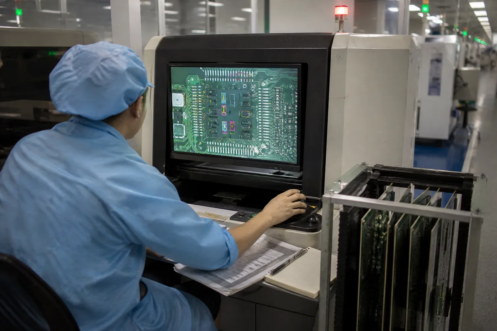

SPI verifies solder paste before placement. AOI verifies visible features after reflow — presence, polarity, offset, fillet shape. X-ray verifies joints hidden under packages, especially BGA and QFN. None of the three verifies electrical function, and none replaces a functional test.

## What each station is actually proving

| Station | When it inspects | What it proves | What it cannot see |
| --- | --- | --- | --- |
| SPI | After paste print, before placement | Paste volume, height, area, offset per pad | Anything about the component or the joint |
| AOI | After reflow | Presence, polarity, rotation, offset, fillet shape, bridging | Anything under a package or in shadow |
| X-ray | After reflow | Voids, bridging, head-in-pillow, ball collapse under BGA/QFN | Component presence, value, or function |

The useful reading of that table: **the three stations cover three different moments, not three levels of the same check.**

## Where defects actually get through

Optical inspection is a contrast problem before it is an algorithm problem. These are the recurring blind spots:

- **Black component on black solder mask.** Low contrast means a marginal offset can pass.
- **Anything under a package.** AOI is line-of-sight; a BGA joint is not in the line of sight. This is precisely why X-ray exists.
- **Shadowed joints on a dense board.** Tall components cast occlusion; an inspector or an algorithm sees the top of the shadow, not the joint.
- **Solder voids below the reporting threshold.** X-ray will show a void; whether it matters is a specification question, not a detection question.
- **Wrong value, right package.** A 10 kΩ resistor substituted for a 1 kΩ one looks identical. No optical or X-ray station catches this — only electrical test or incoming verification does.
- **Weak or cold joints that are still shaped correctly.** A joint can be visually acceptable and electrically intermittent.

That last row is the one that costs money in the field, because it passes every inspection station and fails in the customer's hands.

## So what closes the gap?

Three things that are not inspection:

1. **In-circuit test or flying probe** — proves connectivity and component values.
2. **Functional test** — proves the assembly does what it is for, under power.
3. **Boundary scan** — reaches nets that probing cannot touch.

A program that claims "full inspection" and stops at AOI has covered placement, not function. A program that claims "100% tested" needs to say which of the three above it means.

## What a supplier should be able to tell you

- Which stations run in line, and on which products — not which machines are owned.
- What the first-article process is, and who signs it off.
- What happens to a board that fails AOI: rework, re-inspect, or scrap — and whether rework is re-inspected at the same station.
- Whether functional test exists for your product, and who writes the fixture.

If the answer to the last one is "the customer tests it", then the inspection claim covers assembly only. That is a legitimate arrangement — it just needs to be stated, because the buyer's risk sits after the point where the supplier stopped looking.

## Why this matters commercially

Inspection claims are easy to inflate and hard to audit. A manufacturer that says "we have AOI and X-ray" has told you about equipment. One that says "we catch placement defects optically, hidden joints by X-ray, and connectivity by flying probe — but not component value drift over temperature" has told you where your risk is.

Shenzhen Tengmei Technology runs SPI, AOI and X-ray in line on its Yamaha YSM20/YSM10 lines; the [assembly page](/assembly.html) describes where each station sits in the flow, and [capabilities](/capabilities.html) lists the equipment. Electrical test is quoted per project rather than claimed as standard, because the fixture is product-specific.
